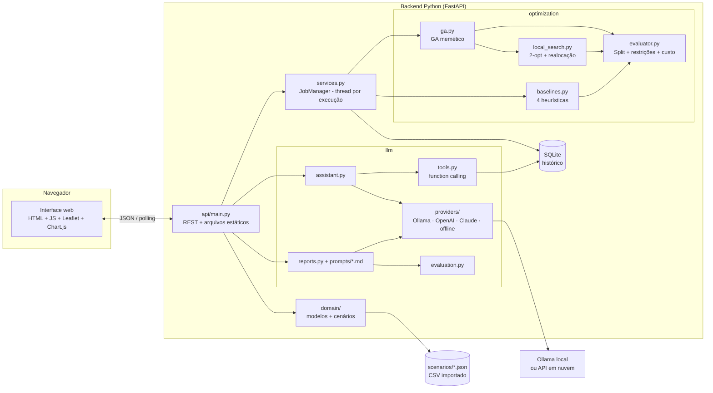
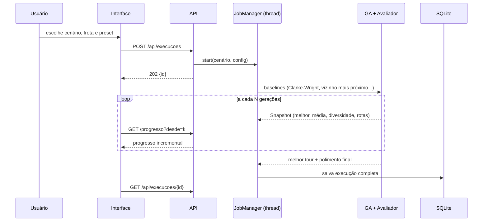
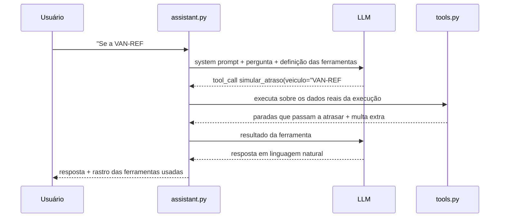

# Arquitetura

## Visão geral

## Camadas

| Camada | Pacote | Responsabilidade | Depende de |
|---|---|---|---|
| Domínio | `rotavital.domain` | Entidades (`Stop`, `VehicleType`, `Scenario`), validação, leitura de JSON/CSV | - |
| Otimização | `rotavital.optimization` | Avaliação de soluções, GA, busca local, heurísticas e experimentos | domínio |
| LLM | `rotavital.llm` | Provedores, ferramentas, prompts, relatórios e avaliação de qualidade | storage |
| Persistência | `rotavital.storage` | Histórico de execuções e textos gerados (SQLite) | - |
| Serviço | `rotavital.services` | Orquestra uma execução em segundo plano e publica o progresso | otimização, storage |
| API | `rotavital.api` | Endpoints REST e entrega da interface | todas |
| Interface | `rotavital/web/static` | SPA sem etapa de build | API |

O núcleo de otimização não conhece a API nem a LLM. Ele pode ser usado por linha de
comando (`experiments.py`), por testes ou por outra interface.

## Fluxo de uma otimização

## Fluxo do assistente (function calling)

Contingências: se o modelo não suporta ferramentas, um contexto compacto vai no próprio
prompt; se a LLM está indisponível, um roteador de intenções responde com as mesmas
ferramentas (modo offline).

## Decisões de arquitetura

| Decisão | Alternativas consideradas | Motivo |
|---|---|---|
| FastAPI + SPA estática | Streamlit, Dash | API documentada (OpenAPI em `/docs`), interface de produto, progresso ao vivo via polling, separação clara frontend/backend |
| Sem etapa de build no frontend | React/Vite | Avaliador roda com `make app`; bibliotecas via CDN com versão fixa |
| Python puro no núcleo (sem numpy) | numpy/numba | O Split é sequencial (DP incremental); listas Python + cache de fitness bastam (~25 s para 40 paradas) |
| Thread por execução + polling | Celery/Redis, WebSocket | Infra mínima para um projeto acadêmico; o contrato de progresso é incremental (`desde=k`) |
| SQLite | PostgreSQL | Zero configuração; suficiente para histórico e relatórios por período |
| Ollama como LLM padrão | API paga em nuvem | Gratuito, offline, sem chave exposta no repositório; modelos LLaMA citados no enunciado |
| Prompts em arquivos `.md` | strings no código | Versionamento, revisão e citação no relatório técnico |
| Modo offline determinístico | falhar sem LLM | A aplicação e os testes nunca dependem de serviço externo |

## Escalabilidade e monitoramento

- **Execuções concorrentes**: cada otimização roda em uma thread própria; o cache de
  fitness é por execução. Para escalar horizontalmente, o `JobManager` pode ser trocado
  por uma fila (ex.: Cloud Tasks ou Celery) sem mudar a API.
- **Contêiner**: `Dockerfile` + `docker-compose.yml` (app + Ollama). A imagem é *stateless*
  (dados em volume) e pode ir para Cloud Run ou ECS com autoescala por requisições.
- **Observabilidade**: cada execução registra gerações, avaliações de fitness, tempo, motivo
  de parada e curva de convergência; cada texto da LLM fica salvo com provedor, modelo e
  nota de qualidade (`GET /api/execucoes/{id}/textos`).
