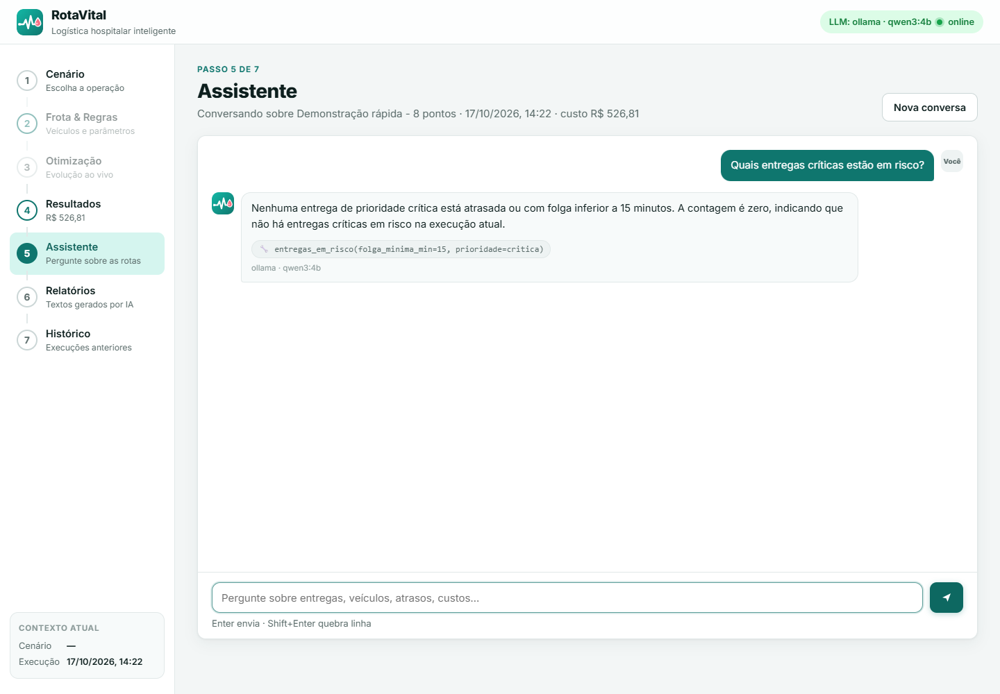

# Validação da integração Qwen3 — 17/10/2026

O RotaVital é o projeto principal. A configuração local usa seu próprio runtime
Ollama 0.40.4 e o mesmo Qwen3 4B Q4_K_M importado no protótipo anterior. A API
confirmou o digest `9a09256a51fe03679e2c348cfcb337dd7cbfe3cbeed790db4eba1b854f46d3b2`.

## Verificações automatizadas

A linha de base tinha **46 testes aprovados**. Após a integração e a correção de
prioridade, **60 testes passaram**. A checagem de dependências não encontrou
incompatibilidades; Ruff nos arquivos Python alterados, análise de sintaxe do
JavaScript e `git diff --check` passaram.

Os novos testes verificam parâmetros do Qwen3, `think=false`, ausência de proxy,
respostas inválidas/vazias, erros do backend, digest do modelo, contingência
configurável, erro HTTP 503 e distinção entre prioridade alta e crítica.
São testes de contrato com cliente falso, não uma avaliação de qualidade de LLM.

## Chamadas reais pela API

Foi criada uma execução `sp-mini-8`, com população 20, 10 gerações e semente 2026,
usando a mesma API do formulário. As três respostas vieram de `ollama / qwen3:4b`;
o verificador não aceita contingência como evidência de inferência.

| Pergunta | Tempo observado | Revisão |
|---|---:|---|
| Entregas críticas em risco | 150,1 s | **Falhou semanticamente:** trouxe uma entrega alta e a chamou de crítica |
| Distância/retorno da MOTO #1 | 65,7 s | Conferido: 35,82 km e retorno 12:28 |
| Trânsito em tempo real | 15,6 s | Reconheceu que a informação não está disponível |

Os tempos dependem de carregamento, contexto e tamanho da resposta; não são um
benchmark controlado de hardware. A rodada utilizou CPU (`size_vram=0`).

## Correção e reteste na interface

A pergunta sobre críticas expôs uma limitação real da interpretação do modelo.
`entregas_em_risco` passou a aceitar prioridade e o assistente fixa o escopo quando
a pergunta menciona uma única categoria. Uma consulta crítica não permite trocar
o filtro por alta. Zero ocorrências é retornado explicitamente como contagem calculada.

O reteste foi realizado no **Edge com perfil temporário**, abrindo a aplicação e
enviando a pergunta pelo formulário. O topo mostrou Qwen3 online, a resposta usou
`entregas_em_risco(folga_minima_min=15, prioridade=critica)` e informou corretamente
que não havia críticas em risco. Não houve erro JavaScript de página nessa navegação.
A captura foi inspecionada visualmente. O teste não solicitou tiles OSM, pois seu
objetivo era o chat.

Esse reteste usa um caso conhecido que orientou a correção; não é uma medida de
generalização ou garantia de que todas as respostas futuras estarão corretas.

## Evidências e reprodução

- [Resumo com respostas iniciais, falha e reteste](evidencias/qwen3-integracao.json).
- [Execução usada como referência](evidencias/qwen3-run.json).
- JUnit local: `data/evidencias/qwen3-tests.xml`.
- Chamada inicial completa: `data/evidencias/qwen3-4afa2b63/`.
- Resposta/captura do reteste: `data/evidencias/chat-ui-6c1cd59d/`.

Para repetir, siga [Qwen3 local](qwen3-local.md). Com o aplicativo iniciado,
`python scripts/verify-qwen3.py` cria outra execução e outra pasta de evidências.
Para a verificação visual opcional, instale `playwright` no ambiente de desenvolvimento
e execute `python scripts/verify-chat-ui.py --run-id ID`; o script usa o Edge já
instalado, sem baixar ou alterar o navegador e sem usar o perfil pessoal.

A integração não modificou o algoritmo, o avaliador de custos ou os cenários do
RotaVital. Não foi executada uma revisão completa dessas partes, uma nova bateria
de experimentos de otimização nem uma avaliação real dos relatórios nesta rodada.
